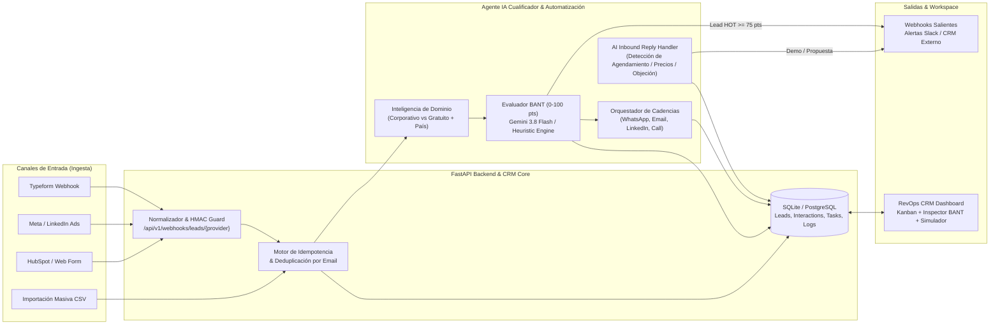

# NexusLead AI — Agente Cualificador de Leads B2B (BANT) & CRM de Automatización Comercial

> **Executive Summary (EN):** Production-grade AI Lead Qualification Agent & Commercial Automation CRM built with **FastAPI**, **Google Gemini API (`google-genai`)**, **SQLAlchemy 2.0**, and an interactive **RevOps Kanban & BANT Inspector Workspace**. Automates multi-channel lead ingestion (HMAC-signed Webhooks for Typeform, Meta Ads, HubSpot, and CSV batches), corporate domain intelligence, 4-pillar **BANT scoring (0–100)**, adaptive multi-channel follow-up sequences (WhatsApp, Email, LinkedIn, Call), and AI-driven inbound reply handling.

---

## Qué demuestra este proyecto (Arquitectura & Habilidades)

Este proyecto resuelve un problema real de **Ingeniería de Operaciones de Ingresos (RevOps) y Automatización con IA**: eliminar el cuello de botella entre la captación de un lead B2B y su seguimiento comercial.

1. **IA Aplicada a Procesos Reales (`Google Gemini 3.8 Flash` + Fallback Determinista BANT):**
   - Evalúa automáticamente cada prospecto bajo la metodología **BANT** (*Budget, Authority, Need, Timeline* — 0 a 25 puntos por pilar = **0 a 100 puntos**).
   - Detecta intención de compra, nivel de ajuste con el **ICP (Ideal Customer Profile)**, objeciones probables, *talking points* para el ejecutivo y asigna el dueño ideal (*AE Senior Enterprise*, *SDR Mid-Market*, *Nurturing Bot* o *Self-Serve*).
   - **Modo Dual sin fricción:** Si configuras `GEMINI_API_KEY`, utiliza salidas estructuradas JSON de `gemini-3.8-flash` mediante el SDK oficial `google-genai`. Si no hay API key configurada, opera automáticamente con su motor heurístico BANT integrado para que cualquier reclutador o entorno CI/CD pueda probar el 100% del flujo sin bloqueos ni costos.
2. **APIs & Webhooks Multi-Canal con Seguridad Criptográfica:**
   - Endpoints normalizadores para payloads heterogéneos de **Typeform**, **Meta Lead Ads**, **LinkedIn Ads**, **HubSpot** y **Formularios Web** (`POST /api/v1/webhooks/leads/{provider}`).
   - Verificación de firma **HMAC-SHA256** (`X-Webhook-Signature`) y token secreto (`X-Webhook-Secret`).
   - **Idempotencia y Deduplicación Inteligente:** Si un mismo email vuelve a ingresar por otro canal o campaña, el motor fusiona/enriquece los campos nuevos sin duplicar registros e incrementa el contador de re-interacción.
3. **Automatizaciones Comerciales & Agente de Respuestas Entrantes:**
   - **Cadencias Adaptativas por Tier:**
     - `HOT (>= 75 pts)`: Secuencia *Fast-Track* en 3 pasos (WhatsApp inmediato + Email de arquitectura a las 2h + Llamada de AE Senior a las 24h) + disparo de **Webhook Saliente** a Slack/CRM.
     - `WARM (50–74 pts)`: Secuencia consultiva en 3 pasos (Email diagnóstico + LinkedIn a las 48h + Caso de éxito al día 5).
     - `COLD (30–49 pts)`: Secuencia educativa automatizada (Calculadora ROI a las 24h + Guía técnica al día 7).
   - **AI Inbound Reply Handler (`POST /api/v1/automation/leads/{id}/reply`):** Cuando el lead responde un correo o WhatsApp, el agente clasifica su intención (`book_meeting`, `pricing_inquiry`, `objection`, `unsubscribe`), **cancela/pausa automáticamente los seguimientos pendientes** para no enviar spam, avanza la tarjeta en el pipeline (`meeting_scheduled`, `proposal_sent`, `lost`) y redacta la respuesta contextual.
4. **CRM Core & Workspace RevOps en Tiempo Real:**
   - Tablero **Kanban** de 6 columnas, **Tabla BANT Responsiva** con filtros combinados, **Inspector BANT** con barras de desglose, trazabilidad completa (`lead_interactions`), monitor de Webhooks y **Simulador en 1 Clic para Reclutadores**.

---

## Arquitectura del Sistema



---

## Matriz de Cualificación BANT (0 a 100 Puntos)

| Pilar | Rango | Qué evalúa el Agente IA |
| :--- | :---: | :--- |
| **B — Budget** (Presupuesto) | `0 – 25 pts` | Presupuesto declarado en USD (`>= $25k` Enterprise, `$10k–$24k` Mid-Market, `< $3k` ajustado) correlacionado con la escala de empleados (`company_size`). |
| **A — Authority** (Autoridad) | `0 – 25 pts` | Nivel de decisión del cargo (`C-Level/Founder`, `VP/Director`, `Manager`, `Analista/Estudiante`) + bonificación/penalización por **Inteligencia de Dominio** (dominio corporativo vs `gmail.com`/`outlook.com`). |
| **N — Need** (Necesidad) | `0 – 25 pts` | Claridad del dolor comercial, encaje técnico con automatización/IA/CRM y urgencia operativa expresada en `primary_need` y `pain_points`. |
| **T — Timeline** (Urgencia) | `0 – 25 pts` | Horizonte de implementación (`immediate` < 30 días, `1_3_months`, `3_6_months`, `exploring`). |

### Clasificación y Ruteo Automático

- **🔥 HOT (`75 – 100 pts`):** Avanza a `qualified` → Asignado a **AE Senior Enterprise** → Activa cadencia *Fast-Track* (WhatsApp + Email + Llamada 24h) + Alerta Webhook saliente.
- **⚡ WARM (`50 – 74 pts`):** Avanza a `qualified` → Asignado a **SDR Mid-Market** → Activa cadencia consultiva de 3 pasos.
- **❄️ COLD (`30 – 49 pts`):** Avanza a `nurture` → Asignado a **Nurture Bot** → Activa secuencia educativa sin consumir horas de ejecutivos.
- **🚫 DISQUALIFIED (`< 30 pts`):** Avanza a `lost` → Filtrado automático (ej. correos personales sin presupuesto o tareas académicas).

---

## Inicio Rápido (Local y Docker)

### Opción 1: Ejecución con Docker Compose (1 comando)

```bash
docker compose up --build
```

La aplicación estará disponible en:
- **Workspace CRM & Simulador en Vivo:** http://localhost:8000
- **Documentación Interactiva OpenAPI (Swagger):** http://localhost:8000/docs
- **Healthcheck:** http://localhost:8000/health

### Opción 2: Ejecución Local con Entorno Virtual Python

```bash
# 1. Crear y activar entorno virtual
python -m venv .venv
# En Windows (PowerShell):
.\.venv\Scripts\Activate.ps1
# En Linux/macOS:
# source .venv/bin/activate

# 2. Instalar dependencias
pip install -r requirements.txt

# 3. (Opcional) Configurar variables de entorno
cp .env.example .env
# Puedes agregar tu GEMINI_API_KEY en .env o dejarla vacía para usar el motor BANT integrado

# 4. Iniciar servidor
uvicorn app.main:app --reload --port 8000
```

---

## Ejemplos de Uso de la API y Webhooks (`cURL`)

### 1. Ingerir y cualificar un Lead vía API REST
```bash
curl -X POST http://localhost:8000/api/v1/leads \
  -H "Content-Type: application/json" \
  -d '{
    "full_name": "Roberto Fuentes",
    "email": "rfuentes@minera-andina.cl",
    "job_title": "CEO & Co-Founder",
    "company_name": "Minera Andina Tech",
    "company_size": "201-1000",
    "industry": "Mining & Logistics",
    "estimated_budget_usd": 38000,
    "primary_need": "Automatizar cualificación de leads B2B y seguimiento comercial con IA",
    "timeline_urgency": "immediate"
  }'
```

### 2. Recibir un Webhook de Meta Lead Ads (con secreto de verificación)
```bash
curl -X POST http://localhost:8000/api/v1/webhooks/leads/meta_ads \
  -H "Content-Type: application/json" \
  -H "X-Webhook-Secret: whsec_nexus_lead_demo_2026" \
  -d '{
    "leadgen_id": "meta_99812",
    "campaign_name": "B2B_AI_Q4",
    "field_data": [
      {"name": "full_name", "values": ["Carolina Pizarro"]},
      {"name": "work_email", "values": ["cpizarro@agrotech-latam.com"]},
      {"name": "company_name", "values": ["AgroTech Latam"]},
      {"name": "job_title", "values": ["CEO"]},
      {"name": "budget", "values": ["28000"]},
      {"name": "timeline", "values": ["immediate"]},
      {"name": "need", "values": ["Agente IA para seguimiento comercial en WhatsApp y CRM"]}
    ]
  }'
```

### 3. Simular la respuesta entrante de un Lead (AI Reply Handler)
```bash
curl -X POST http://localhost:8000/api/v1/automation/leads/1/reply \
  -H "Content-Type: application/json" \
  -d '{
    "channel": "whatsapp",
    "message": "Hola equipo, me interesa mucho la propuesta. ¿Podemos agendar una demo mañana jueves a las 11:00 AM?"
  }'
```

---

## Suite de Pruebas Automatizadas (`pytest`)

El proyecto cuenta con pruebas unitarias, de integración y *end-to-end* que validan las 5 fases:

```bash
pytest -v
```

- `tests/test_phase1_crm_ingestion.py`: Creación, deduplicación idempotente por email, Webhooks firmados con HMAC-SHA256 (`typeform`, `meta_ads`), importación CSV y transiciones de etapa.
- `tests/test_phase2_ai_qualifier.py`: Scoring BANT (0–100), inteligencia de dominio corporativo vs gratuito, re-cualificación manual, por lotes y previsualización sin estado.
- `tests/test_phase3_automation.py`: Inscripción automática en cadencias adaptativas multi-canal, ejecución de pasos, Webhooks salientes y análisis de respuestas entrantes (agendamiento, precios, baja).
- `tests/test_phase4_dashboard_and_simulator.py`: Servicio del dashboard estático, semilla de datos realistas y los 5 escenarios del simulador en 1 clic.
- `tests/test_phase5_e2e_pipeline.py`: Ciclo de vida comercial completo desde el webhook de entrada hasta el cierre del contrato (`won`).

---

## Estructura del Proyecto

```text
ai-lead-qualifier-crm/
├── app/
│   ├── core/
│   │   ├── config.py             # Variables de entorno y flags de automatización
│   │   └── database.py           # Motor SQLAlchemy 2.0 y sesión de base de datos
│   ├── models/
│   │   └── lead.py               # Modelos ORM: Lead, LeadInteraction, FollowUpTask, WebhookEventLog
│   ├── routers/
│   │   ├── leads.py              # CRUD CRM, filtros, KPIs e importación CSV/Batch
│   │   ├── webhooks.py           # Ingesta multi-proveedor y validación HMAC-SHA256
│   │   ├── ai_agent.py           # Endpoints de cualificación individual, masiva y preview
│   │   ├── automation.py         # Cola de secuencias multi-canal y AI Reply Handler
│   │   └── demo.py               # Semilla de datos y simulador en 1 clic para reclutadores
│   ├── schemas/
│   │   ├── lead.py               # Esquemas Pydantic v2 de entrada/salida CRM
│   │   ├── ai_qualification.py   # Esquemas de desglose BANT e inteligencia de dominio
│   │   └── automation.py         # Esquemas de secuencias y análisis de respuestas
│   ├── services/
│   │   ├── crm_service.py        # Lógica de negocio CRM y deduplicación idempotente
│   │   ├── webhook_ingestor.py   # Normalizadores para Typeform, Meta Ads, HubSpot y HMAC
│   │   ├── ai_qualifier.py       # Motor dual Gemini 3.8 Flash + Heurística BANT
│   │   ├── automation_service.py # Orquestador de cadencias, respuestas IA y webhooks salientes
│   │   └── seed_service.py       # Generador de escenarios realistas de demostración
│   └── main.py                   # Punto de entrada FastAPI, ciclo de vida y montaje estático
├── static/
│   ├── index.html                # Interfaz del Workspace RevOps (Kanban, Tabla, Modales nativos)
│   ├── styles.css                # Sistema de diseño oscuro de alto contraste y tabla responsiva
│   └── app.js                    # Lógica cliente, Inspector BANT y Simulador en vivo
├── tests/                        # Suite completa de tests por fase (pytest)
├── Dockerfile                    # Contenedor optimizado con usuario no-root y healthcheck
├── docker-compose.yml            # Orquestación lista para producción
└── requirements.txt              # Dependencias fijadas
```
